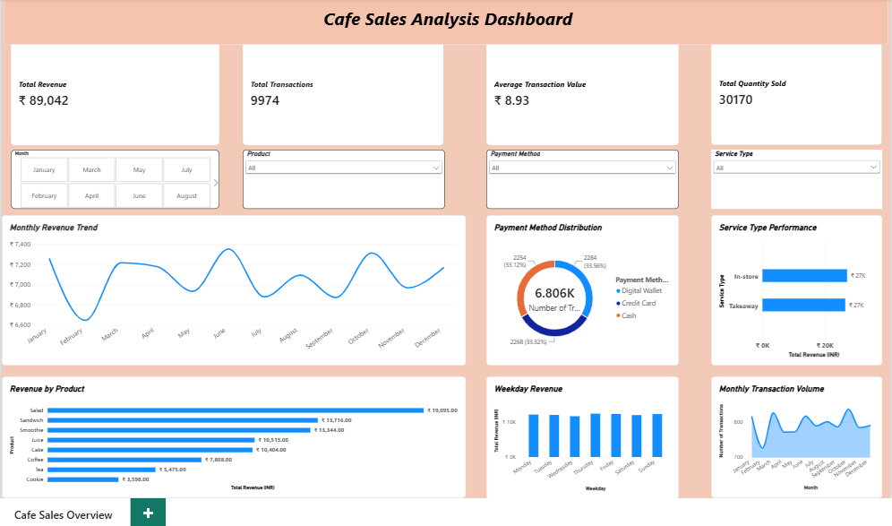

# Cafe Sales Analysis

## 1. Project Overview

This project analyses cafe sales data to understand sales performance, product preferences, transaction behaviour, payment methods, and service types. The workflow covers data cleaning with Python, exploratory data analysis (EDA), and an interactive Power BI dashboard.

The analysis uses a transactional dataset containing 10,000 original records. After cleaning, 9,974 records were retained for analysis.

## 2. Project Objectives

- Inspect and clean raw cafe sales data.
- Analyse revenue, transaction volume, and purchase quantities.
- Identify product-level sales and spending patterns.
- Compare payment methods and service types.
- Explore monthly and weekday sales trends.
- Communicate key metrics and findings through a Power BI dashboard.

## 3. Tools & Technologies

| Tool | Purpose |
|---|---|
| Python | Data analysis and preparation |
| Pandas | Data cleaning and manipulation |
| NumPy | Numerical operations |
| Matplotlib | Data visualisation |
| Jupyter Notebook | Analysis environment |
| Power BI | Interactive dashboard |
| Git & GitHub | Version control and project hosting |

## 4. Data Cleaning & Preparation

The raw dataset was inspected and cleaned using Python and Pandas.

Key preparation steps and checks included:
- Reviewed data types, missing values, duplicate records, and invalid entries.
- Recovered some missing product and price information where the available data supported an unambiguous mapping.
- Removed 26 records with unresolved missing values in essential transaction fields.
- Retained 460 records with missing transaction dates rather than discarding otherwise usable transaction information.
- Validated that Quantity × Price Per Unit matched Total Spent for all 9,974 retained records.

**Result:** 10,000 original records were reduced to 9,974 cleaned records. The cleaned dataset contains no duplicate rows and no missing values in Quantity, Price Per Unit, or Total Spent. Transaction Date remains missing in 460 records.

**Notebook:** [Data Cleaning](notebooks/Cafe_sales_analysis.ipynb)  
**Cleaned data:** [cafe_sales_cleaned.csv](data/cafe_sales_cleaned.csv)

## 5. Exploratory Data Analysis (EDA)

EDA was performed in Python to examine product performance, payment behaviour, transaction distributions, time-based trends, and service types.

The analysis includes:
- Overview and descriptive statistics
- Product analysis
- Payment method analysis
- Univariate analysis
- Time-based analysis
- Service-type analysis

For analyses grouped by date, the 460 records with missing Transaction Date were excluded; therefore, date-based analysis uses 9,514 records with valid dates. Unknown category values were excluded from relevant product, payment-method, and service-type comparisons so that category-level findings represent known values.

**Notebook:** [Exploratory Data Analysis](notebooks/Cafe_Sales_EDA.ipynb)

## 6. Key Business Findings

### 6.1 Product Analysis

- **Sales volume:** Coffee recorded the highest sales volume at 3,904 units, followed by Salad at 3,819 units. Smoothie recorded the lowest at 3,336 units.
- **Transaction frequency:** Coffee appeared in the highest number of transactions (1,286), followed by Salad (1,270). Smoothie had the lowest frequency (1,094).
- **Average spending:** Salad had the highest average transaction spending at ₹15.04. Cookie had the lowest at ₹2.97.
- **Unit price:** Salad had the highest average selling price at ₹5.00 per unit, while Cookie had the lowest at ₹1.00.
- **Monthly product revenue:** Salad generated the highest revenue among known products in each month. Its revenue peaked in July at ₹1,715.

### 6.2 Payment Method Analysis

- Cash had the highest average transaction value at ₹9.05, followed by Credit Card at ₹9.01 and Digital Wallet at ₹8.93.
- Credit Card generated the highest total revenue at ₹20,446. Revenue from Digital Wallet and Cash was close, at ₹20,405 and ₹20,402.50 respectively.
- Digital Wallet recorded the highest transaction count among known payment methods (2,284).
- The median purchase quantity was 3 units across all three payment methods.

### 6.3 Transaction Behaviour

- Across 9,974 retained transactions, average transaction value was ₹8.93 and the median was ₹8.
- Transaction amounts ranged from ₹1 to ₹25; the middle 50% fell between ₹4 and ₹12.
- Friday had the highest transaction count (1,383), while Tuesday had the lowest (1,308).
- The average purchase quantity was approximately 3.02 units, with a median of 3 units.

### 6.4 Time-Based Analysis

- June recorded the highest monthly revenue at ₹7,353, followed by October at ₹7,314. February had the lowest at ₹6,644.
- Thursday generated the highest weekday revenue at ₹12,401.50.
- April had the highest monthly average transaction value (approximately ₹9.31); July had the lowest (approximately ₹8.72).
- October recorded the highest monthly transaction volume (837), while February had the lowest (726).
- Higher transaction volume did not always correspond to higher revenue: June generated more revenue than October despite having fewer transactions.

### 6.5 Service-Type Analysis

- In-store transactions generated ₹27,140 in revenue, compared with ₹26,552.50 for Takeaway.
- Average transaction value was slightly higher for In-store (₹9.03) than Takeaway (₹8.80).
- Transaction counts were nearly equal: Takeaway recorded 3,016 and In-store 3,006 among records with known service-type information.

## 7. Power BI Dashboard

The interactive Power BI dashboard brings together the project's headline metrics and sales breakdowns.

### Dashboard KPIs

| Metric | Value |
|---|---:|
| Total Revenue | ₹89,042 |
| Total Transactions | 9,974 |
| Average Transaction Value | ₹8.93 |
| Total Quantity Sold | 30,170 |

### Dashboard Preview

**Power BI report:** [Download the PBIX file](powerbi/Cafe_Sales_Dashboard.pbix)

## 8. Conclusion

The analysis shows that Coffee led product sales volume, while Salad had the highest average transaction spending. Payment-method revenue was closely distributed, and In-store transactions generated slightly more revenue than Takeaway. Monthly results varied, with June leading in revenue and October leading in transaction volume. These findings provide a concise view of product performance and transaction patterns in the available cafe sales data.

## 9. Dataset & Credits

- **Dataset:** [Cafe Sales - Dirty Data for Cleaning Training](https://www.kaggle.com/datasets/ahmedmohamed2003/cafe-sales-dirty-data-for-cleaning-training)
- **Creator:** Ahmed Mohamed
- **Dataset license:** CC BY-SA 4.0 (as stated on the dataset source).

The original dataset is credited to its creator. The cleaning, analysis, visualisations, and dashboard in this repository are the project work.

## 10. Project Code License

The project code license has not yet been selected. The dataset's CC BY-SA 4.0 license applies to the dataset under its terms; it does not automatically determine the license for this project's original code and analysis.
